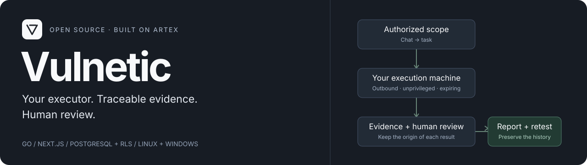
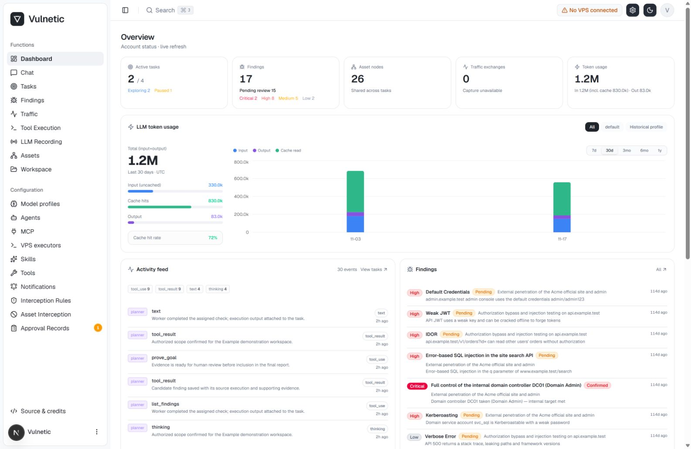
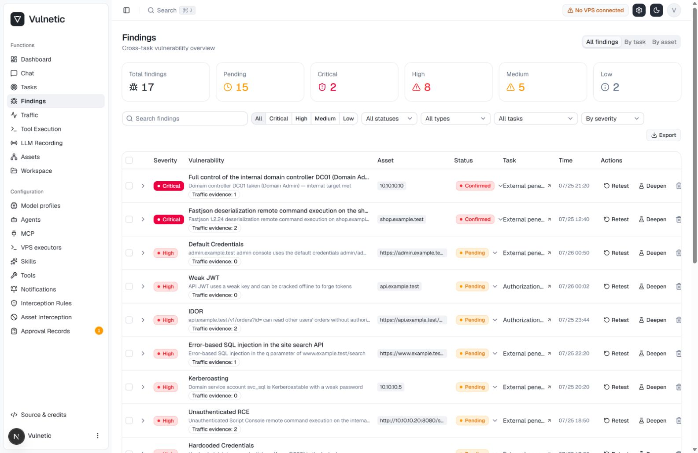
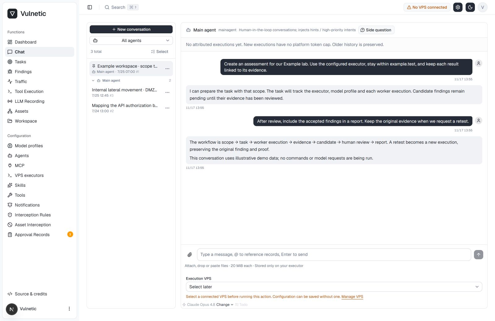
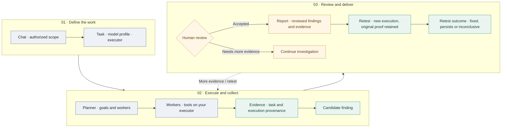
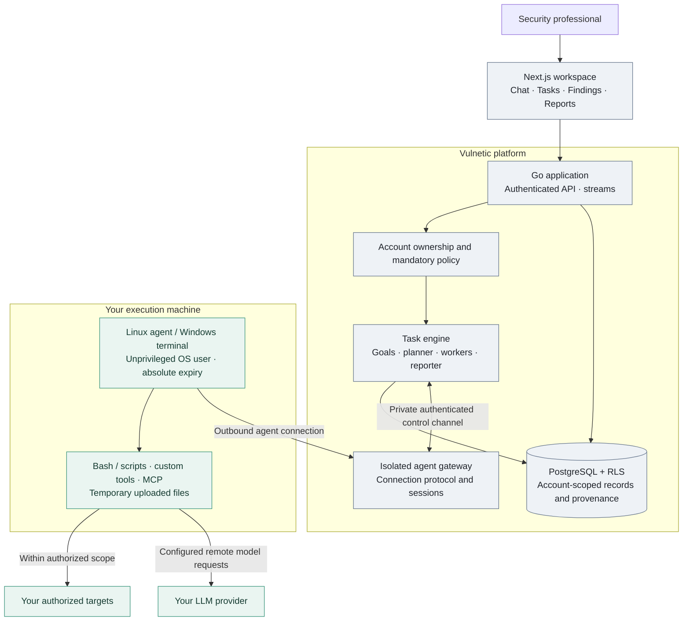

<p align="center"></p>

# Vulnetic — ARTEX-based Security Workspace

**Bring your executor. Keep the evidence. Review every finding.**

An open-source, ARTEX-derived workspace for security professionals and small teams. Plan authorized assessments with AI agents, execute tools on your own Linux VPS or Windows machine, and keep findings connected to their evidence, reports and retests.

**[Create a free account](https://vulnetic.site/setup/)** · **[Explore Vulnetic](https://www.vulnetic.site)** · **[Download complete source](https://github.com/sordado123/vulnetic-core/releases/tag/source-2026-11-17)** · **[Source & credits](https://vulnetic.site/source/)**

Go backend · Next.js frontend · PostgreSQL + RLS · Customer-owned execution · AGPL-3.0

[Screenshots](#inside-the-workspace) · [Workflow](#from-scope-to-evidence) · [Architecture](#how-the-pieces-connect) · [Self-build](#build-and-inspect-the-source) · [ARTEX & licenses](#built-on-artex-credited-properly)

## Inside the workspace

### One view of the assessment

Tasks, findings awaiting review, recent activity and model usage in the same workspace.



### Findings that keep their context

Filter by severity, status, task or asset. Inspect linked evidence before deciding what belongs in the report; request a retest without replacing the original record.



### Start with a conversation

Discuss the authorized scope, select the execution context and follow the work from chat into a task.



*Screenshots show the actual interface running locally with synthetic demo data. Names, findings, messages and usage figures are illustrative, not customer results or a benchmark. No live assessment or model request was run for these captures.*

## Why Vulnetic?

ARTEX established the multi-agent foundation. Vulnetic develops that foundation into an account-isolated workspace with customer-owned execution and a reviewable path from a question to a finding.

| What you need | What Vulnetic provides |
| --- | --- |
| Start from a conversation | Chat can inspect available executors and model profiles, then create or follow a task within the account. |
| Run tools where you control them | An outbound agent connects your Linux VPS or a Windows terminal to the platform. Customer tools run on that selected executor. |
| Know when access ends | Expiring, revocable execution authorization. Supported Linux service reconnection keeps the original deadline; Windows terminal access ends when its process closes. |
| Keep evidence traceable | Findings retain task/execution provenance, supporting proof, report and retest history. |
| Separate a lead from a conclusion | Candidate and verified states, with human review. An auxiliary agent may review evidence; model text alone does not establish a verified finding. |
| Work with your own model | Save an LLM profile before connecting an executor; connectivity tests and model requests follow the configured execution boundary. |
| Keep accounts apart | Account ownership checks, PostgreSQL RLS, encrypted persisted credentials and execution-policy enforcement. |

## From scope to evidence



The model proposes actions. Application code enforces ownership, execution permissions and protected-target policy. External pages, files and tool responses remain untrusted input. These boundaries reduce the impact of prompt injection; they are not a claim of absolute immunity.

## How the pieces connect

The workspace coordinates the assessment. Your executor runs customer tools. A separate gateway handles the agent connection, while account permissions and execution policy stay in application code.



This is a component and trust-boundary overview, not a network firewall diagram. Execution authorization is revocable and expires at its original deadline. The gateway does not receive the application's database, vault or JWT credentials. New uploaded attachments stay on the selected executor; findings, reports and their recorded evidence retain platform-side history.

## Start with the hosted workspace

1. [Create a free account](https://vulnetic.site/setup/).
2. Save your own LLM profile. You can connect the executor afterward.
3. Add an executor and run the generated command on your Linux VPS or Windows terminal.
4. Choose the executor, model and authorized scope for a task.
5. Follow execution, inspect evidence, review findings and request a report or retest.

The hosted workspace is free at launch. You supply the model/provider access and execution machine; those providers may charge separately. Only assess systems you own or are explicitly authorized to test, within the agreed scope.

## The executor, explained

The agent opens an outbound connection. Customer commands are not run locally on the platform server. Linux installation uses administrative access to create the service and dedicated user; the running agent has no sudo. Windows uses a foreground process with the current non-administrator user's permissions, without installing a service.

Closing the Windows terminal ends that access. Linux reconnection and reboot recovery are bounded by the original authorization deadline. Revocation, expiration and the platform's mandatory policy checks still apply. The executor has the permissions of its operating-system account; it is not a sandbox against every other process on that customer machine.

## Build and inspect the source

This repository is a source release. It contains complete versioned module trees rather than a misleading standalone copy of one agent entry point.

| Component | Source directory |
| --- | --- |
| Current hosted application 1.1.5+e70e7e6dc6ab | [sources/e70e7e6dc6ab](sources/e70e7e6dc6ab) |
| Historical application, frontend and gateway baseline | [sources/5dd361d9b11d](sources/5dd361d9b11d) |
| Linux/Windows executor and shared packages | [sources/83c2ce102c8a](sources/83c2ce102c8a) |
| Proof reconciler | [sources/f92615b76a05](sources/f92615b76a05) |

The source-offer update used by the hosted app is listed in [SOURCE-VERSIONS.md](SOURCE-VERSIONS.md). Both the baseline versions and the update remain available.

The complete source archive in [Releases](https://github.com/sordado123/vulnetic-core/releases/tag/source-2026-11-17) also includes the original sources for all **52 declared Go modules**. Git contains their index and locked hashes; the dependency ZIPs live in the release asset to keep the repository practical to clone. Both original npm lockfiles and exact source/integrity locators are supplied.

Prerequisites for the supplied Windows reconstruction recipe: **Go 1.26.3, Node.js 22, npm and PowerShell 7**. Windows is required for its Windows resource step.

```powershell
git clone https://github.com/sordado123/vulnetic-core.git
cd vulnetic-core
pwsh ./reconstruction/rebuild.ps1 -WorkDirectory C:\vulnetic-build
```

The build directory must not already exist. The recipe fetches locked dependencies and builds locally; it does not start an executor, create a customer account or deploy the hosted service. See [DEPENDENCIES.md](DEPENDENCIES.md) and [the recorded independent build](reconstruction/results.json).

Historical Docker/toolbox and lab recipes are source references. No container images, downloaded external-tool binaries, native npm packages or newly compiled product executables are published in this source release. Do not treat those recipes as a pre-audited image distribution.

## Source release, with honest limits

- The independent reconstruction compiled the frontend and seven product binaries. Linked Go dependency versions and checksums matched their historical originals. This is not byte-for-byte reproducibility or an end-to-end security certification.
- No claim of superiority over ARTEX is made without reproducible comparative evidence.
- Windows executors are unsigned. Source availability is not an antivirus clearance or verified-publisher signature.
- No customer accounts, conversations, findings, uploaded files, credentials, executor tokens or private deployment history belong in this repository.
- Known historical provenance uncertainty is documented in [LICENSE-REVIEW.md](LICENSE-REVIEW.md); it is not filled with invented checkout identities.

## Built on ARTEX, credited properly

Vulnetic derives from **[ARTEX](https://github.com/BaaRai/ARTEX)** by Autumn-27 and contributors, including BaaRai's maintained fork. It is an independent continuation, not the official ARTEX project or an endorsed edition.

The combined program remains **[AGPL-3.0](LICENSE)**. Third-party components retain their own licenses and notices. Norma is incorporated with modifications under Apache-2.0. Vulnetic uses a port of **[acp-kernel](https://github.com/ranxianglei/acp-kernel)**, Copyright © 2026 ranxianglei; its historical MIT and later attribution texts are preserved. See [CREDITS.md](CREDITS.md), [THIRD_PARTY_NOTICES.md](THIRD_PARTY_NOTICES.md) and [LICENSE-RESOLUTIONS.json](LICENSE-RESOLUTIONS.json).

## Contributing

Read [CONTRIBUTING.md](CONTRIBUTING.md). Use synthetic examples or your own local fixtures in public issues. Never post live customer material, credentials, private keys or executor connection commands. For security-sensitive reports, see [SECURITY.md](SECURITY.md).
